<picture>
  <source media="(prefers-color-scheme: dark)" srcset="./assets/banner-dark.svg">
  
</picture>

<p align="center">
  <a href="https://www.linkedin.com/in/sreyash-singh-5bbbba320/"></a>
  <a href="mailto:officialsreyash25@gmail.com"></a>
  <a href="https://morphconvert.pages.dev"></a>
</p>



### About me

```dart
final sreyash = Developer(
  role:      ['Flutter developer', 'Student founder', 'Hackathon regular'],
  building:  ['Morph', 'Right Posture', 'Odyssy', 'ClipBridge'],
  learning:  ['Clean architecture + Riverpod', 'Supabase and Node.js'],
  askMeAbout: 'Shipping MVPs fast with Flutter + Supabase',
  funFact:   'More ideas than finished repos (working on it)',
);
```

### Tech stack

<p align="center">
  <br>
  
</p>

### Stats

<p align="center">
  
</p>

### Contribution snake

<picture>
  <source media="(prefers-color-scheme: dark)" srcset="https://raw.githubusercontent.com/itsofficially-sreyash/itsofficially-sreyash/output/github-snake-dark.svg">
  
</picture>
